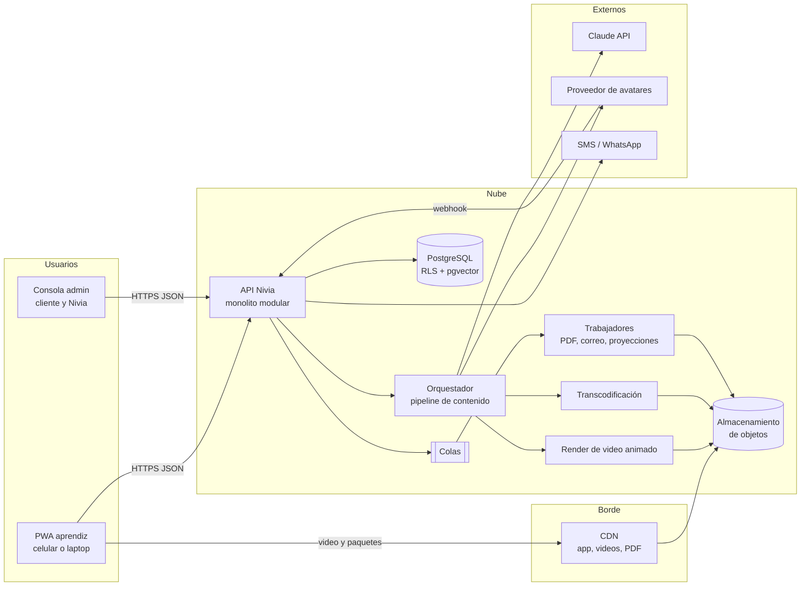
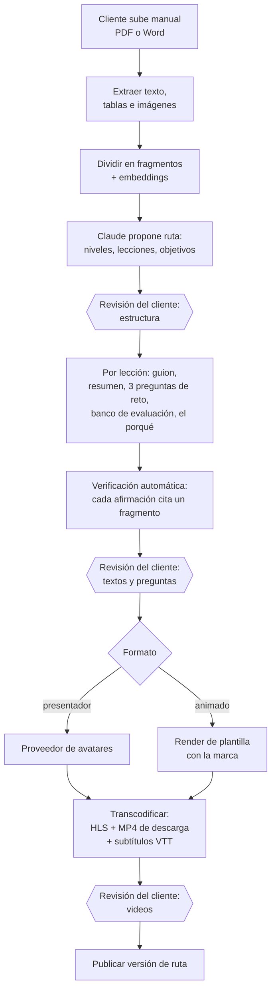
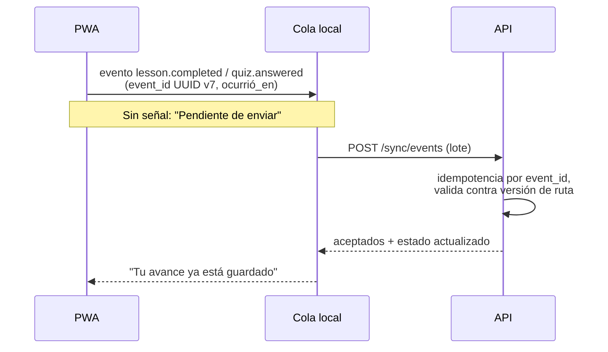

# Nivia · Backend y arquitectura

**Estado:** propuesta v0.1 para discutir · 2 de noviembre de 2026
**Base:** lo que piden los Cortes 1 y 2 (rol aprendiz) y la promesa del producto: el cliente entrega su manual y Nivia lo convierte en video con IA, en una ruta con dinámica de juego y en un certificado con la marca del cliente.

Este documento propone **cómo construirlo**. Las decisiones marcadas como **Abierta** están en la sección 12 con una recomendación; el resto es la propuesta por defecto.

---

## 1. Qué tiene que resolver el backend

| Necesidad | De dónde sale | Consecuencia técnica |
|---|---|---|
| Marca blanca: cada empresa ve su logo, colores, reglas y certificado | Corte 1 | Multi-tenant desde el primer día; configuración por cliente servida por la API |
| Ingreso con celular y contraseña, contraseña temporal, recuperación por código | Corte 1 | Autenticación propia por teléfono, envío de SMS o WhatsApp, cambio forzado en primer ingreso |
| Rutas por niveles, lecciones en video, retos de 3 preguntas | Corte 1 | Modelo de contenido versionado; progreso por lección |
| Evaluación con nota mínima, intentos, espera y duración configurables | Corte 1 | El servidor es la autoridad: elige preguntas, mide el tiempo y califica |
| Certificado con código de verificación | Corte 1 | Emisión transaccional, PDF con la marca, código no adivinable |
| Aprender sin señal y no perder avance | Corte 2 | Aplicación que funciona sin red, paquetes descargables por lección, cola de eventos con envío idempotente |
| La evaluación siempre requiere conexión | Corte 2 | El intento vive en el servidor; el celular solo guarda respuestas de respaldo |
| Del manual al video, la ruta y los retos | Producto | Flujo de trabajo largo con IA, proveedores externos de video y revisión humana |
| Operarios con celulares de gama media y datos limitados | Ambos cortes | Video adaptativo de bajo peso, CDN cerca de Perú, aplicación liviana |

## 2. Principios

1. **Monolito modular primero.** Un solo servicio de API con módulos bien separados y trabajadores asíncronos aparte. Con un equipo pequeño, microservicios agregan costo sin beneficio.
2. **El servidor manda en lo que da valor legal.** Evaluaciones, notas y certificados se deciden solo en el servidor. Lecciones y retos (bajo riesgo) aceptan avance hecho sin señal.
3. **Todo pertenece a un cliente.** Cada fila lleva `tenant_id` y la base de datos lo hace cumplir, no solo el código.
4. **La IA propone, una persona aprueba.** Nada generado por IA llega a un aprendiz sin revisión del cliente, y cada pregunta guarda la parte del manual de la que sale.
5. **Proveedores detrás de interfaces.** El generador de avatares, el modelo de lenguaje, SMS y almacenamiento se cambian sin tocar el dominio.
6. **Contenido publicado es inmutable.** Una versión de ruta publicada no se edita; se publica otra.

## 3. Decisiones principales

| Tema | Propuesta | Por qué | Alternativa |
|---|---|---|---|
| Aplicación del aprendiz | PWA (web instalable) con service worker | Un solo código para Android, iOS y laptop; actualizaciones inmediatas; el prototipo ya es web | App con contenedor nativo (Capacitor) si iOS limita las descargas (ver riesgo R1) |
| Consola de administración | Aplicación web en el mismo repositorio | Comparte componentes, marca blanca y autenticación | — |
| Lenguaje | TypeScript en frontend, API y trabajadores | Un solo lenguaje para un equipo pequeño; tipos compartidos de la API | **Abierta** según el equipo |
| API | Node.js con framework modular (NestJS) | Módulos, inyección de dependencias y validación listos | Fastify con módulos propios |
| Base de datos | PostgreSQL gestionado, con Row Level Security por `tenant_id` y `pgvector` | Relacional, transaccional, aislamiento por cliente en la base, búsqueda semántica del manual sin otro servicio | Base separada por cliente solo para clientes que lo exijan |
| Colas | Cola gestionada (SQS) para tareas cortas | Simple, barata, reintentos y cola de errores | Redis con BullMQ |
| Flujos largos | Orquestador de flujos (AWS Step Functions) para el pipeline de contenido | Pasos de minutos u horas, esperas por webhooks del proveedor de video y por aprobación humana, reintentos visibles | Temporal |
| Archivos | Almacenamiento de objetos (S3) + CDN | Manuales, videos, subtítulos y PDF; URLs firmadas | Cloudflare R2 + CDN |
| Video | Transcodificación gestionada (MediaConvert) a HLS adaptativo y MP4 de descarga | Streaming que se adapta a la señal y archivo liviano para ver sin señal | FFmpeg en contenedores propios |
| Nube | AWS, región São Paulo (`sa-east-1`) + CDN con presencia en Lima | Región más cercana con todos los servicios gestionados | **Abierta**: GCP Santiago |
| Modelo de lenguaje | Claude por API: `claude-sonnet-5-5` para generar, `claude-haiku-5-5` para clasificar | Buena calidad en español y en documentos largos; caché de prompts para el manual | **Abierta** |
| Video con avatar | Proveedor externo de avatares (tipo presentador UGC) vía API y webhook | Producir presentadores realistas no es el núcleo de Nivia | **Abierta**: elegir proveedor |
| Video animado | Render propio de plantillas HTML a video en un trabajador | Control total de la marca del cliente y costo bajo por video | Proveedor externo |
| SMS / WhatsApp | Proveedor con cobertura en Perú detrás de una interfaz | Código de recuperación hoy; recordatorios después | **Abierta** |

## 4. Vista general

## 5. Componentes

### 5.1 PWA del aprendiz

- Pantallas de los Cortes 1 y 2, con la marca que entrega `GET /tenant/config`.
- **Service worker:** guarda la aplicación para abrir sin señal, intercepta las descargas de lecciones y reenvía la cola de eventos al volver la red.
- **Almacenamiento local:**
  - IndexedDB para el estado (rutas, progreso, cola de eventos, respuestas de respaldo de la evaluación).
  - Cache Storage para los paquetes de lección (MP4, subtítulos, JSON).
- Pide almacenamiento persistente (`navigator.storage.persist()`) y mide el espacio real con `navigator.storage.estimate()`. Esto reemplaza el espacio simulado del prototipo.

### 5.2 API (monolito modular)

| Módulo | Responsabilidad |
|---|---|
| `tenants` | Clientes, marca (logo, colores con validación de contraste AA al guardar), reglas de evaluación, dominio |
| `identity` | Usuarios, teléfonos, contraseñas, códigos, sesiones por dispositivo, roles |
| `catalog` | Rutas, versiones, niveles, lecciones, recursos de video, preguntas |
| `assignments` | Quién debe hacer qué ruta y para cuándo; vencimientos |
| `learning` | Progreso, recepción de eventos sin señal, proyección "dónde me quedé" |
| `assessment` | Intentos de evaluación, tiempo, calificación, temas a reforzar |
| `certification` | Emisión, PDF, código de verificación, vigencia, renovación, revocación |
| `offline` | Paquetes descargables por lección: tamaño, URL firmada, versión |
| `content-pipeline` | Manuales, fragmentos, trabajos de generación, revisión y publicación |
| `feedback` | "Reportar un problema con este contenido" |
| `notifications` | SMS y WhatsApp (hoy solo códigos) |
| `audit` | Registro de acciones sensibles |

Los módulos se hablan por interfaces internas y eventos de dominio, nunca leyendo tablas de otro módulo. Así, separar uno más adelante es posible sin reescribir.

### 5.3 Pipeline de contenido con IA

- **Anclaje al manual:** cada guion, pregunta y "por qué" guarda `source_refs` (página y sección). La consola los muestra al lado para que el revisor compare. Si la verificación encuentra una afirmación sin fuente, el texto vuelve a generarse o queda marcado para revisión.
- **Vocabulario de la operación:** se extrae un glosario del manual (candado, tarjeta, válvula, solicitud SC) y se pasa a cada generación.
- **Costo y repetición:** el manual se cachea en el prompt, de modo que generar 30 lecciones no reenvía el documento completo cada vez.
- **Etiqueta "Hecho con IA":** cada recurso guarda su origen (generado o subido) y la PWA muestra la etiqueta según ese dato.

### 5.4 Video: generación, entrega y descarga

| Salida | Uso | Calidad sugerida |
|---|---|---|
| HLS adaptativo | Ver con señal | 240p, 360p, 540p y 720p, vertical 9:16 |
| MP4 de descarga | Ver sin señal | Una sola versión 360p con audio, unos 1 a 1,5 MB por minuto |
| Subtítulos VTT | Subtítulos activables | Generados del guion, no quemados en la imagen |
| Portada JPG | Miniaturas | 360 px |

Una lección de 4 minutos pesaría unos 5 a 8 MB para descargar, menos que los 15 a 90 MB que simula el prototipo. El tamaño real se guarda en `lesson_asset.size_bytes` y es lo que ve el aprendiz antes de confirmar.

> El video de demostración actual tiene subtítulos quemados en la imagen. En producción los subtítulos van en un archivo VTT aparte, para que se puedan activar y desactivar.

### 5.5 Datos

Entidades principales (todas con `tenant_id`, salvo `tenant`):

| Grupo | Entidades |
|---|---|
| Cliente | `tenant`, `tenant_branding`, `exam_policy`, `tenant_domain` |
| Personas | `user`, `user_phone`, `credential`, `otp_challenge`, `device_session`, `membership` (rol: aprendiz, supervisor, admin) |
| Contenido | `manual`, `manual_chunk` (con embedding), `route`, `route_version`, `level`, `lesson`, `lesson_asset`, `question` (con `source_refs`) |
| Asignación | `group`, `assignment` (ruta + versión + persona o grupo + `due_at`) |
| Aprendizaje | `progress_event` (bitácora inmutable), `lesson_progress` (proyección), `quiz_result` |
| Evaluación | `exam_attempt`, `attempt_answer` |
| Certificado | `certificate`, `certificate_event` (emitido, renovado, revocado) |
| Operación | `generation_job`, `content_report`, `audit_log`, `outbox` |

- **Aislamiento:** cada conexión fija `app.tenant_id` y las políticas RLS filtran todas las tablas. Una consulta olvidada no puede leer otro cliente.
- **Versiones:** quien empezó una ruta sigue en la versión que empezó. Una nueva versión solo aplica a asignaciones nuevas o a renovaciones (**Abierta**).
- **Bitácora más proyección:** el progreso se guarda como eventos inmutables y una proyección rápida para la pantalla de Inicio. Esto facilita el envío sin señal y la auditoría.

## 6. Flujos críticos

### 6.1 Ingreso, primer ingreso y recuperación

1. El cliente identifica a la empresa por subdominio (`riomar.nivia.pe`) o por código. Un mismo celular puede existir en dos empresas.
2. `POST /auth/login` con celular (E.164) y contraseña (hash Argon2id). Hay límite de intentos por celular y por IP.
3. Si la contraseña es temporal, la respuesta lo indica y solo permite `POST /auth/password` y `PATCH /me` hasta cambiarla.
4. Para recuperar: `POST /auth/otp` envía un código de 6 dígitos con 10 minutos de vida y 3 intentos. `POST /auth/otp/verify` entrega un permiso de un solo uso para fijar la nueva contraseña.
5. **Sesión:**
   - Token de acceso de 15 minutos.
   - Token de renovación rotativo, ligado al dispositivo, de 30 días. Sin señal no se necesita token: la sesión local sigue abierta y se renueva al volver la red.
   - "Cerrar sesión" revoca la sesión del dispositivo.

### 6.2 Avance sin señal y envío

Reglas de combinación:

- **Completar es irreversible:** una lección completada no vuelve atrás.
- **Posición del video:** se queda la mayor.
- **Retos:** se guardan todos los intentos con su hora real.
- **Rechazos:** si un evento no aplica (ruta retirada, lección de otra versión), se guarda como rechazado y la respuesta lo informa. Nunca se descarta en silencio.

### 6.3 Evaluación

1. `POST /assignments/:id/attempts` (solo con señal) valida intentos restantes y espera. Elige preguntas al azar del banco, balanceadas por lección, y devuelve el intento con `deadline_at` calculado en el servidor.
2. Cada respuesta se guarda con `PUT /attempts/:id/answers/:q`. El celular guarda además una copia local por si se corta la señal.
3. **Señal cortada a mitad:**
   - El servidor registra el tiempo con latidos cada 15 s.
   - Si dejan de llegar, el tiempo se congela hasta un máximo de pausa (sugerido: 10 minutos acumulados, **Abierta**).
   - Al reanudar, la app reenvía las respuestas locales y el servidor recalcula el tiempo restante.
4. `POST /attempts/:id/submit` califica en el servidor y devuelve nota, temas a reforzar (de las lecciones de origen de cada pregunta errada), intentos restantes y hora de reintento.
5. Si al vencer el plazo no hubo envío, un trabajador cierra el intento y califica lo respondido.

### 6.4 Certificado

1. Aprobar y crear el certificado ocurren en una sola transacción. Un evento en la tabla `outbox` dispara la generación del PDF.
2. El trabajador genera el PDF desde una plantilla HTML con la marca del cliente, lo guarda y lo sirve con URL firmada.
3. **Código de verificación:** prefijo del cliente y año más 4 caracteres aleatorios sin caracteres ambiguos y un dígito de control (como `RIO-2026-4F7K-21`). Es único y no secuencial.
4. **Vigencia:** `expires_at` según la regla del cliente. Un trabajador diario marca los certificados próximos a vencer y crea la asignación de renovación (el caso de Marisol).
5. Verificación pública por código: fuera de alcance hoy; el modelo ya la soporta.

## 7. API principal

| Método y ruta | Uso |
|---|---|
| `GET /tenant/config` | Marca, textos y reglas del cliente |
| `POST /auth/login` · `/auth/otp` · `/auth/otp/verify` · `/auth/password` · `/auth/refresh` · `/auth/logout` | Ingreso y sesión |
| `GET /me` · `PATCH /me` | Ficha (área) |
| `GET /home` | Inicio: asignaciones ordenadas por urgencia, siguiente lección, avisos |
| `GET /assignments/:id` | Ruta de esa asignación con niveles, estados y bloqueo |
| `GET /lessons/:id` | Lección: video HLS, subtítulos, resumen, reto |
| `GET /lessons/:id/offline-package` | Tamaño y URL firmada del paquete de descarga |
| `POST /sync/events` | Eventos de avance (con o sin señal) |
| `GET /assignments/:id/exam` | Reglas de la evaluación y estado de intentos |
| `POST /assignments/:id/attempts` · `PUT /attempts/:id/answers/:q` · `POST /attempts/:id/heartbeat` · `POST /attempts/:id/submit` | Evaluación |
| `GET /certificates` · `GET /certificates/:id` · `GET /certificates/:id/pdf` | Certificados |
| `POST /content-reports` | Reportar un problema con el contenido |

Contrato en OpenAPI, con tipos generados para la PWA y la consola. Los errores usan códigos estables (`EXAM_REQUIRES_CONNECTION`, `ATTEMPTS_EXHAUSTED`, `RETRY_AFTER`) para que el frontend muestre los textos ya redactados en los cortes.

## 8. Seguridad y privacidad

- **Datos personales mínimos:** nombre, celular, área, empresa. No se pide DNI en este alcance.
- **Ley N.° 29733 de Protección de Datos Personales y su reglamento** (validar con asesoría legal):
  - Inscribir los bancos de datos ante la autoridad.
  - Informar la transferencia internacional, porque los servidores están fuera del Perú.
  - Definir el rol de Nivia como encargado del tratamiento frente a cada empresa cliente.
- **Cifrado:** en tránsito (TLS) y en reposo (base, objetos, copias de respaldo).
- **Archivos:** videos y PDF solo con URL firmada de corta duración. Los paquetes descargados quedan en el celular del aprendiz, un riesgo aceptado (el contenido es de capacitación interna).
- **Abuso:** límites de intentos en ingreso y códigos, bloqueo temporal, alertas.
- **Auditoría** de acciones de administradores: publicar, revocar certificados, importar personas.
- **Proveedores de IA** configurados para no retener ni entrenar con los manuales de los clientes, según sus condiciones empresariales.

## 9. Infraestructura y operación

- **Entornos:** desarrollo, staging y producción, cada uno en su cuenta de nube.
- **Infraestructura como código** (Terraform o CDK). Despliegue continuo desde la rama principal con aprobación manual a producción.
- **Cómputo:** contenedores gestionados (ECS Fargate) para la API y los trabajadores. Render de video animado en tareas por lote que escalan a cero.
- **Base de datos:** PostgreSQL gestionado con réplica en otra zona, copias diarias y recuperación a un punto en el tiempo de 7 días.
- **Observabilidad:**
  - Registros estructurados con `tenant_id` y `request_id`; trazas distribuidas; métricas de negocio.
  - Ejemplos: lecciones completadas, eventos pendientes de enviar, intentos cerrados por tiempo, trabajos de generación fallidos.
- **Alertas:** caída de la API, cola de errores con mensajes, webhooks del proveedor de video que no llegan.
- **Costos que más pesan:** generación de video con avatar (por minuto), luego tokens del modelo y salida de CDN. La API y la base son menores a esta escala. Conviene medir el costo por lección publicada desde el primer cliente.

## 10. Escala de referencia (supuesto)

| Métrica | Primer año |
|---|---|
| Empresas cliente | 30 |
| Aprendices activos | 15.000 |
| Lecciones publicadas | 1.500 (50 por cliente) |
| Pico de uso | Cambios de turno: unos 1.500 aprendices en 15 minutos |
| Streaming | 15.000 × 30 lecciones × 4 min × 1,5 MB ≈ 2,7 TB al año |

Un monolito con 2 a 4 contenedores y una base de tamaño medio cubre esta carga con holgura. El riesgo de escala está en el pipeline de video, no en la API.

## 11. Plan por fases

| Fase | Entrega | Incluye |
|---|---|---|
| 0. Fundaciones | Esqueleto en producción | Repositorio, CI/CD, IaC, tenants, identidad, observabilidad |
| 1. Corte 1 real | Aprendiz de punta a punta | Rutas, lecciones, retos, evaluación en servidor y certificados en PDF. El equipo de Nivia carga el contenido y los videos (pipeline asistido, no automático) |
| 2. Corte 2 real | Aprender sin señal | PWA sin red, paquetes de descarga, cola de eventos, evaluación interrumpida |
| 3. Pipeline con IA | Del manual a la ruta | Consola de revisión para el cliente, generación anclada al manual, avatares y animado automáticos |
| 4. Supervisión | Lo que muestra la landing | Panel del supervisor, recordatorios por WhatsApp, verificación pública del certificado |

Las fases 1 y 2 pueden avanzar en paralelo con la 3: al principio, el equipo de Nivia usa el pipeline internamente mientras se construye la consola para clientes.

## 12. Decisiones abiertas

| # | Decisión | Recomendación |
|---|---|---|
| D1 | Lenguaje y framework del backend | TypeScript + NestJS, salvo que el equipo domine otro stack |
| D2 | Nube y región | AWS São Paulo + CDN con presencia en Lima |
| D3 | Proveedor de video con avatar | Probar 2 proveedores con el mismo guion y medir calidad en español peruano, costo por minuto y tiempo de entrega |
| D4 | Proveedor de SMS o WhatsApp | WhatsApp para recordatorios; SMS como respaldo de códigos |
| D5 | Identificar la empresa al ingresar | Subdominio por cliente; código de empresa si hay celulares compartidos entre clientes |
| D6 | Pausa máxima en una evaluación cortada | 10 minutos acumulados; después el tiempo corre |
| D7 | Qué versión de ruta sigue quien ya empezó | La que empezó; la nueva aplica a asignaciones nuevas y renovaciones |
| D8 | PWA o app con contenedor nativo | PWA. Probar descargas en iOS en la fase 2 y pasar a contenedor solo si falla |
| D9 | Base compartida o separada por cliente | Compartida con RLS; separada solo por contrato |

## 13. Riesgos

| # | Riesgo | Mitigación |
|---|---|---|
| R1 | Safari en iOS limita y puede borrar el almacenamiento de una PWA no instalada | Pedir instalar en pantalla de inicio y almacenamiento persistente; plan B con contenedor nativo |
| R2 | El contenido generado contiene errores de seguridad industrial | Anclaje al manual con citas, verificación automática y aprobación obligatoria del cliente |
| R3 | Costo variable alto del video con avatar | Mezclar presentador y animado; reutilizar escenas; medir costo por lección |
| R4 | Trampa en la evaluación usando la pausa por señal | Pausa máxima, preguntas al azar, registro de latidos y auditoría |
| R5 | Conflictos de avance entre dos dispositivos | Eventos idempotentes, reglas de combinación monotónicas, proyección recalculable |
| R6 | Dependencia de un proveedor de IA o video | Interfaces de adaptador y contenido final guardado en almacenamiento propio |
